# Partie théorique

## Partie 1 - Questions de compréhension

1. Définir l’architecture microservices.

C'est construire un projet en le découpant en plusieurs services indépendant. Un service = une part métier. 

2. Citer trois avantages des microservices.

Déploiement indépendant, maintenable facilement et scalable.

3. Quelle différence existe-t-il entre microservices et architecture monolithique ?

Bah la structure du projet ?

4. Pourquoi la conteneurisation est-elle importante pour les microservices ?

Pcq pour chaque service on peut l'exécuter tout seul dans son conteneur. 

5. Quels sont les avantages des conteneurs par rapport aux machines virtuelles ?

Déploiement et scalable plus simple, léger, démarre plus vite.

## Partie 2 - Docker

1. Expliquer le rôle de Docker dans une architecture microservices.

Propose 1 conteneur pour chaque service.

2. Que contient un conteneur ?

Chaque conteneur contient un service, donc son code et tous ses fichiers de config -> tout pour que le service (app) puisse se lancer sans soucis indépendemment des autres.

3. Quelle est la différence entre une image Docker et un conteneur Docker ?

Image = template, permet de créer des conteneurs | conteneur = instance (en train de run)

4. Donner les avantages de Docker en matière de portabilité, de reproductibilité et de déploiement.

Une app marche pareil partout si elle est dans un conteneur.\
Donc on peut avoir de même comportement partout pour tout le monde.\
Image = facile et rapide à lancer et scalable.

## Partie 3 - Docker Compose

1. Pourquoi utiliser Docker Compose ?

Pour gérer plein de conteneur d'un coup depuis le même endroit.

2. Donner un exemple d’application nécessitant plusieurs conteneurs.

Jsp frr y'en a plein, moi j'ai utilisé compose dans WorkAdventure avec un conteneur pour le back, le front, la db et probablement d'autres.

3. Que permet de simuler Docker Compose ?

On simule des config de test pour savoir si on peut déployer, on peut démarrer des services dans l'ordre qu'on veut, on peut les faire communiquer entre eux 

## Partie 4 - Kubernetes

1. Pourquoi Docker seul ne suffit-il pas toujours en production ?

Pcq docker s'occupe des conteneurs de leur côté, il est pas taillé pour gérer une app entière. 

2. Définir : Pod, Deployment, Service, PersistentVolumeClaim (PVC), Secret et ConfigMap.

Pod = contient des conteneurs sur un même réseau/stockage.\
Deployment = gère les pods.\
Service = gérer la visibilité des pods dans un cluster.\
PVC = stocke les données d'un pod.\
Secret = stocke les info sensibles et les propose aux pods.\
ConfigMap = stocke les fichiers de config.

3. Expliquer : rolling update, auto-scaling et haute disponibilité.

rolling update = mets les pod à jour sans stopper l'application, pod par pod.\
auto scalling = gère nombre de pod selon la charge pour opti les ressources du serveur.\
haute dispo = permet de garder les services en marche même si d'autres sont en panne.

## Partie 5 - Questions avancées

1. Différence Docker vs Kubernetes

Docker
- Type : Plateforme de conteneurisation.
- Rôle principal : Créer, exécuter et gérer des conteneurs individuels.
- Fonctionnement :
  - Docker s’occupe d’empaqueter l’application et ses dépendances dans un conteneur.
  - Idéal pour le développement et le déploiement d’un ou plusieurs conteneurs sur une seule machine.
- Limite : Ne gère pas la coordination, la mise à l’échelle ou la haute disponibilité de plusieurs conteneurs sur plusieurs machines.

Kubernetes
- Type : Orchestrateur de conteneurs.
- Rôle principal : Gérer des applications multi-conteneurs à grande échelle sur un cluster de machines.
- Fonctionnalités :
  - Déploiement automatique des conteneurs.
  - Mise à l’échelle (auto-scaling) et équilibrage de charge.
  - Haute disponibilité et tolérance aux pannes.
  - Gestion des secrets, configurations, stockage persistant.

2. Monolithe modulaire vs micro-services ?
Monolithe modulaire
- Définition : Une application construite comme un seul bloc, mais organisée en modules internes.
- Caractéristiques :
  - Les modules (ex : authentification, commandes, facturation) sont dans la même application.
  - Partage le même processus et la même base de code.
  - Déploiement : une seule unité.
- Avantages :
  - Plus simple à développer et tester au départ.
  - Pas besoin d’infrastructure complexe.
- Limites :
  - Scalabilité limitée (on ne peut pas scaler un module seul).
  - Mise à jour d’un module = redéploiement de toute l’application.
  - Moins résilient : une erreur dans un module peut affecter toute l’application.

Micro-services
- Définition : Une application découpée en plusieurs services indépendants, chacun correspondant à une fonctionnalité métier.
- Caractéristiques :
  - Chaque service est autonome, avec sa propre base de données si nécessaire.
  - Communique avec les autres via API ou messages.
  - Déploiement indépendant des services.
- Avantages :
  - Scalabilité fine (scaler uniquement les services qui en ont besoin).
  - Mise à jour sans impacter les autres services.
  - Plus résilient : la panne d’un service n’arrête pas l’application entière.
- Limites :
  - Complexité de gestion (réseau, orchestration, monitoring).
  - Besoin d’outils pour orchestrer et superviser (ex : Kubernetes, Docker Compose).

3. Problèmes des micro-services (latence, complexité...) ?
Les micro-services apportent beaucoup d’avantages, mais ils
introduisent aussi certains problèmes et défis, notamment liés à la distribution et à
la complexité. Voici les principaux :

Latence et performances
- La communication entre micro-services se fait souvent via des API réseau ou des messages.
- Chaque appel réseau ajoute du temps de latence, surtout si les services sont nombreux ou distribués sur plusieurs serveurs.
- Les performances peuvent être affectées par des réseaux lents ou instables.

Complexité accrue
- L’application est composée de nombreux services indépendants, ce qui complexifie le développement, le déploiement et la supervision.
- Nécessité d’orchestration (ex : Kubernetes) pour gérer les services, la mise à l’échelle et la tolérance aux pannes.
- Déboguer des erreurs devient plus difficile car elles peuvent traverser plusieurs services.

Cohérence des données
- Chaque service peut avoir sa propre base de données.
- Garantir la cohérence et l’intégrité des données entre services est plus compliqué.
- Les transactions distribuées sont difficiles à gérer.

Gestion des versions et compatibilité
- Les services évoluent indépendamment, ce qui peut créer des problèmes de compatibilité entre versions.
- Il faut gérer les versions d’API et les dépendances entre services.

Surveillance et logging
- Chaque service produit ses propres logs et métriques.
- Il faut des outils spécialisés pour centraliser les logs, monitorer la santé des services et détecter les anomalies.

Coût opérationnel
- Plus de services = plus d’infrastructures (serveurs, conteneurs, orchestration).
- Maintenance et mise à jour plus complexes.

4. Observabilité (logs, metrics, tracing) ?
L’observabilité est la capacité à comprendre le comportement interne d’une
application en examinant ce qu’elle produit : logs, métriques et traces. C’est
particulièrement important pour les architectures micro-services, où de nombreux services
interagissent.

Logs
- Définition : Fichiers ou flux qui enregistrent les événements et actions de l’application.
- Rôle :
  - Déboguer les erreurs.
  - Suivre le comportement d’un service.
- Exemple : “Utilisateur connecté”, “Erreur base de données”, “Commande créée”.

Metrics (métriques)
- Définition : Mesures quantitatives sur le fonctionnement de l’application.
- Rôle :
  - Surveiller la santé et la performance des services.
  - Détecter les anomalies ou pics de charge.
- Exemple : Temps de réponse des API, taux de requêtes, utilisation CPU/mémoire.

Tracing (traces distribuées)
- Définition : Suivi des requêtes à travers plusieurs services.
- Rôle :
  - Identifier où se produisent les goulots d’étranglement.
  - Comprendre les dépendances entre services.
- Exemple : Une requête utilisateur traverse le service front-end -> API -> base
de données -> cache. Le tracing montre chaque étape avec le temps pris.

5. CI/CD et micros-services
L’intégration continue (CI) et le déploiement continu (CD) sont essentiels
pour les micro-services, car ces architectures comportent de nombreux services
indépendants qui évoluent rapidement.

CI (Intégration Continue)
- Définition : Processus automatisé qui intègre régulièrement le code des développeurs dans le dépôt principal.
- Rôle avec micro-services :
  - Tester automatiquement chaque service à chaque modification.
  - Détecter rapidement les erreurs et conflits entre services.
- Exemple : À chaque commit, exécuter des tests unitaires et d’intégration sur le service concerné.

CD (Déploiement Continu / Continuous Delivery)
- Définition : Processus automatisé qui prépare et déploie les services dans différents environnements (test, préproduction, production).
- Rôle avec micro-services :
  - Déployer chaque service indépendamment.
  - Permettre des mises à jour rapides sans interrompre les autres services.
- Exemple : Une nouvelle version du service paiement est automatiquement déployée en production sans affecter le service catalogue.

Avantages pour les micro-services
- Déploiement rapide et fréquent : chaque service peut évoluer indépendamment.
- Réduction des erreurs humaines grâce à l’automatisation.
- Meilleure qualité de code : tests et validation automatiques pour chaque service.
- Scalabilité de l’équipe : plusieurs équipes peuvent travailler sur différents services en parallèle.

# Partie pratique

## Partie 7 - Analyse de l'architecture initiale

1. Identifier les modules fonctionnels Catalogue, Commande et Paiement ainsi que les composants Eureka, Config Server et Gateway.

Le projet `univ` est un seul projet Maven (un seul `pom.xml`, un seul `src/`) qui contient 6 applications Spring Boot. Chaque appli a sa classe `main` dans `com.ecommerce.launchers` et son profil Spring (`application-<profil>.properties`).

Modules fonctionnels (package `com.ecommerce.univ.*`) :
- Catalogue (`catalogue`) : gestion des produits, CRUD sur `/api/v1/produits`, port 8081, nom Eureka `catalogue-service`.
- Commande (`commande`) : création des commandes et de leurs lignes, changement de statut, `/api/v1/commandes`, port 8082, nom Eureka `commande-service`.
- Paiement (`paiement`) : paiement d'une commande, `/api/v1/paiements`, port 8083, nom Eureka `paiement-service`.

Chaque module métier suit le même découpage : `controller`, `service`, `domain`, `repository`, `dto` (+ mapper), `exception`, `config` et `client` pour ceux qui appellent un autre service.

Composants techniques :
- Eureka Server : `EurekaApplication` (`@EnableEurekaServer`), profil `eureka`, port 8761. Annuaire des services, ne s'enregistre pas lui-même.
- Config Server : `ConfigApplication` (`@EnableConfigServer`), profils `config,native`, port 8888. Sert les fichiers de `configurations/` (`catalogue-service.properties`, `commande-service.properties`...).
- Gateway : `GatewayApplication`, profil `gateway`, port 9000. Spring Cloud Gateway **MVC** (servlet), les routes sont dans `application-gateway.properties` : `/api/v1/produits/**` -> `lb://catalogue-service`, `/api/v1/commandes/**` -> `lb://commande-service`, `/api/v1/paiements/**` -> `lb://paiement-service`.

2. Repérer les dépendances partagées, les classes principales, les accès aux données et les appels entre composants.

Classes principales (`com.ecommerce.launchers`) :

| Classe | Profil | Port | Particularités |
|---|---|---:|---|
| `EurekaApplication` | `eureka` | 8761 | `@EnableEurekaServer` |
| `ConfigApplication` | `config,native` | 8888 | `@EnableConfigServer` |
| `GatewayApplication` | `gateway` | 9000 | routes en properties |
| `CatalogueApplication` | `catalogue` | 8081 | `@EntityScan` + `@EnableJpaRepositories` |
| `CommandeApplication` | `commande` | 8082 | + `@EnableFeignClients` |
| `PaiementApplication` | `paiement` | 8083 | + `@EnableFeignClients` |

Comme tout est dans le même classpath, chaque `main` doit limiter ce que Spring charge avec `scanBasePackages`, `@EntityScan`, `@EnableJpaRepositories` et `excludeName = FilterAutoConfiguration` (sinon la Gateway se lance dans tous les services).

Dépendances partagées (un seul `pom.xml`, donc tout le monde a tout) :
- Spring Boot 4.1.2 : `starter-web`, `starter-data-jpa`, `starter-actuator`, driver `postgresql`.
- Spring Cloud 2025.1.2 : `eureka-server`, `eureka-client`, `config-server`, `openfeign`, `gateway-server-webmvc`.
- `springdoc-openapi` (Swagger), Jersey 3 (transport HTTP du client Eureka), Lombok (déclaré mais pas utilisé dans le code).
- Config commune dans `application.properties` : datasource, JPA `ddl-auto=update`, Swagger, actuator.

Accès aux données :
- Une seule base PostgreSQL `ecommerce` (`localhost:5433`, user `postgres`) partagée par les 3 services métier.
- Catalogue : `ProduitRepository` -> table `produits`.
- Commande : `CommandeRepository` -> tables `commandes` et `lignes_commande` (`@OneToMany` en cascade).
- Paiement : `PaiementRepository` (+ `findByCommandeId`) -> table `paiements`.
- Pas de clé étrangère entre services : une ligne de commande garde `produitId` + une copie du nom et du prix, un paiement garde `commandeId`.

Appels entre composants :
- Client -> Gateway (9000) -> service métier, en `lb://` (Gateway demande l'adresse à Eureka).
- Commande -> Catalogue : `CatalogueClient` (OpenFeign, `GET /api/v1/produits/{id}`) à la création d'une commande pour récupérer nom et prix de chaque produit.
- Paiement -> Commande : `CommandeClient` (OpenFeign, `GET /api/v1/commandes/{id}`) pour récupérer le montant total à payer.
- Tous (sauf Config) -> Eureka : enregistrement et découverte (`EurekaTransportConfig` dans chaque module force le transport Jersey 3).
- Config Server : prévu mais pas branché, `spring.cloud.config.enabled=false` dans `application.properties`, donc aucun service ne lit sa config dessus.

Problèmes repérés en passant (à corriger pendant la migration) :
- `catalogue/config/EurekaTransportConfig` est dans le package `com.ecommerce.catalogue.config` (pas `com.ecommerce.univ...`), d'où le scan en plus dans `CatalogueApplication`.
- Le Config Server cherche `file:./configurations/` alors que les fichiers sont dans `src/main/resources/configurations/`.
- `configurations/gateway-service.properties` utilise les anciennes propriétés `spring.cloud.gateway.routes` (Gateway réactive) et le nom `gateway-service`, alors que l'appli s'appelle `api-gateway` et utilise Gateway MVC.
- `OpenApiConfig` (`com.ecommerce.univ.config`) n'est scannée que par `ConfigApplication`, donc pas par les services qui exposent Swagger.
- `ProduitService.getProduitById` fait un `orElseThrow()` sans exception métier -> erreur 500 au lieu de 404.
- Le README parle de `docker compose up -d` mais il n'y a pas de `docker-compose.yml` dans le dépôt.

3. Expliquer les limites d'un module Maven partagé en matière de dépendances, de compilation et de déploiement indépendant.

Dépendances
- Chaque service embarque les dépendances de tous les autres : le Catalogue a Eureka Server, Config Server, Gateway, Feign... alors qu'il n'en a pas besoin.
- Des auto-configurations se déclenchent pour rien, il faut les désactiver à la main (`excludeName`, `scanBasePackages`, `gateway.server.webmvc.enabled=false`...). Facile d'oublier, et le comportement dépend de ce qui traîne dans le classpath.
- Impossible d'avoir des versions différentes par service : si Paiement a besoin d'une nouvelle version d'une lib, tout le monde la prend.
- Plus de dépendances = plus de failles possibles et des images Docker plus grosses.

Compilation
- Un seul `mvn package` compile les 6 applis : une erreur dans Paiement bloque le build du Catalogue.
- Pas de frontière forcée entre modules : rien n'empêche `commande` d'importer directement une classe de `catalogue`, le couplage peut revenir sans qu'on le voie.
- Les tests et le build prennent toujours le temps de tout le projet, même pour une petite modif.

Déploiement indépendant
- Un seul artefact `univ-0.0.1-SNAPSHOT.jar` pour 6 applis (et même pas exécutable : pas de `spring-boot-maven-plugin`). Il faut choisir la classe `main` et le profil au lancement.
- Une modif dans un service = nouvelle version de l'artefact pour tous, donc pas de versionnement ni de cycle de livraison propre à chaque service.
- On ne peut pas construire une image Docker petite et spécifique par service, ni scaler/mettre à jour un service sans toucher aux autres.
- La base partagée couple aussi les services au niveau des données (un changement de schéma peut casser un autre service).

4. Produire un schéma de l'architecture initiale et un schéma de l'architecture microservices cible.

Architecture initiale : 1 projet Maven -> 1 JAR -> 6 processus lancés avec des profils différents, 1 base partagée.

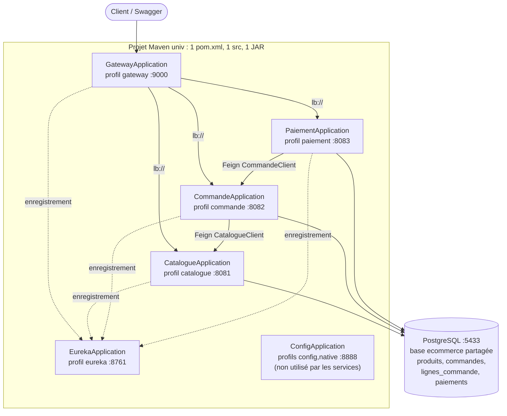

Architecture cible : 6 projets Spring Boot indépendants (un `pom.xml` chacun, parent commun possible), une image Docker par service, une base par service métier, config centralisée sur le Config Server.

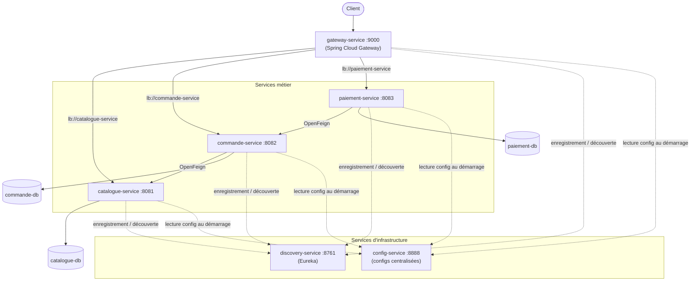

Chaque boîte de la cible = un dossier, un `pom.xml`, une classe `main`, un `Dockerfile` et un conteneur dans `docker-compose.yml` (réseau Docker interne, noms DNS `discovery-service:8761`, `config-service:8888`...).

5. Comparer les deux organisations selon le couplage, la maintenance, la scalabilité et le déploiement.

| Critère | Initiale (module Maven partagé) | Cible (microservices indépendants) |
|---|---|---|
| Couplage | Fort : même classpath, mêmes dépendances, même base, rien n'empêche d'importer les classes d'un autre module | Faible : les services ne se parlent que par REST (Feign) via Eureka, chacun a ses classes et sa base |
| Maintenance | Simple au début (un seul projet à ouvrir) mais le POM grossit, les exclusions et scans manuels se multiplient, une modif peut casser un autre service | Chaque service est petit et lisible, avec ses propres dépendances et tests ; mais il faut gérer plusieurs projets, du code dupliqué (DTO, config Eureka) et la compatibilité des API |
| Scalabilité | On peut lancer plusieurs processus du même JAR, mais tous embarquent tout et partagent la même base, qui devient le goulot | On scale seulement le service chargé (ex : plusieurs `catalogue-service`), la Gateway répartit avec `lb://`, chaque base peut être dimensionnée à part |
| Déploiement | Un seul artefact pour tout : chaque livraison concerne les 6 applis, choix de la classe et du profil à la main, pas d'image par service | Un JAR et une image Docker par service, versionnés séparément ; on redéploie un service sans arrêter les autres, et Docker Compose lance tout d'un coup |

En résumé, l'organisation initiale est pratique pour une démo (tout compile et se lance depuis un seul projet) mais ce n'est pas encore vraiment des microservices : ce sont 6 processus séparés au runtime mais couplés au build et aux données. La cible coûte plus cher à mettre en place (plus de projets, réseau, config distribuée, une base par service) mais donne l'indépendance de dev, de build, de déploiement et de scalabilité attendue.

## Partie 8 - Migration vers des microservices indépendants

Projet `ecommerce-microservices` : 6 modules Maven indépendants (`discovery-service`, `config-service`, `gateway-service`, `catalogue-service`, `commande-service`, `paiement-service`), un POM parent commun, chacun avec sa classe `main` et ses propres dépendances.

- **Code métier** : repris tel quel depuis `univ`, juste le package renommé (`com.ecommerce.univ.<module>` -> `com.ecommerce.<module>`). Couches `controller / service / domain / repository / dto` conservées.
- **Config centralisée** : `config-service` sert les `.properties` de chaque service (mode `native`), avec une base PostgreSQL dédiée par service (`catalogue_db`, `commande_db`, `paiement_db`).
- **Eureka** : `discovery-service` comme annuaire ; les 4 clients (`gateway`, `catalogue`, `commande`, `paiement`) s'y enregistrent.
- **Gateway** : route `/api/v1/produits|commandes|paiements` vers les 3 services via `lb://`.
- **Qualité** : validation (`@Valid` + annotations sur les DTO), gestion d'erreurs (404/400 uniformisée), tests unitaires JUnit5/Mockito sur les 3 services métier (12 tests).
- Bugs corrigés au passage : config server qui ne trouvait pas ses fichiers, routes Gateway en syntaxe obsolète, 500 au lieu de 404 sur un produit absent.

`mvn clean test` : `BUILD SUCCESS` sur les 6 modules.

## Partie 9 - Communication et configuration des microservices

Vérifié sur le stack réellement démarré (6 services + PostgreSQL, bases dédiées) :
```bash
java -jar config-service/target/config-service-0.0.1-SNAPSHOT.jar
java -jar discovery-service/target/discovery-service-0.0.1-SNAPSHOT.jar
java -jar catalogue-service/target/catalogue-service-0.0.1-SNAPSHOT.jar
java -jar commande-service/target/commande-service-0.0.1-SNAPSHOT.jar
java -jar paiement-service/target/paiement-service-0.0.1-SNAPSHOT.jar
java -jar gateway-service/target/gateway-service-0.0.1-SNAPSHOT.jar
```

- **[Eureka](http://localhost:8761/)** : `GET /eureka/apps` confirme les 4 clients `UP` (`catalogue-service`, `commande-service`, `paiement-service`, `gateway-service`).

  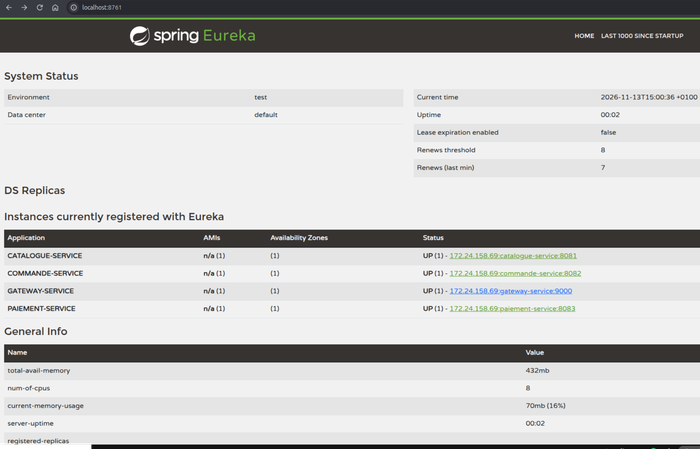

- **Config Server** : chaque service démarre avec seulement `spring.application.name` en local ; port, datasource et routes viennent de `config-service` (un démarrage réussi prouve que la config a bien été reçue). Preuve indirecte : Swagger expose bien le titre personnalisé (`API Catalogue`) défini via la config distribuée.

  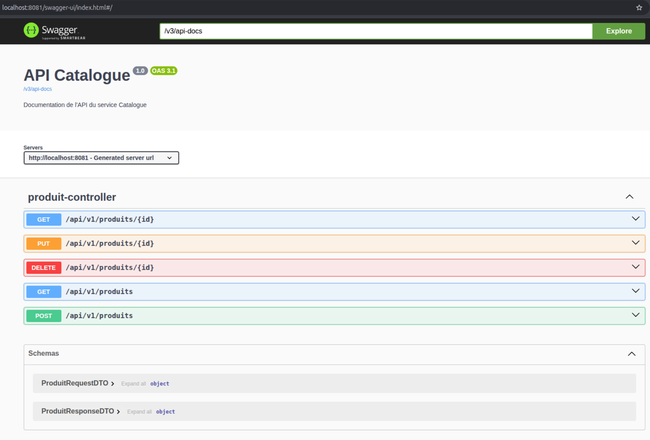

- **Gateway** : `GET /api/v1/produits/1` renvoie le même résultat en direct (8081) et via la Gateway (9000), par `lb://catalogue-service`.

  
  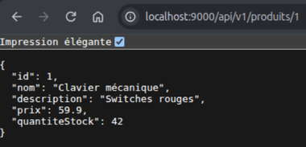

- **OpenFeign** : chaîne testée de bout en bout via Swagger (`Try it out`) - produit créé (Catalogue), commande qui le référence (Commande -> Feign -> Catalogue, montant calculé = prix × quantité), paiement sur cette commande (Paiement -> Feign -> Commande, montant repris de la commande).

  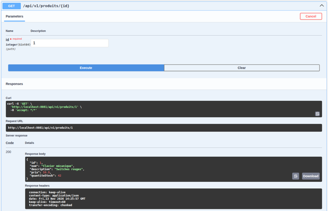
  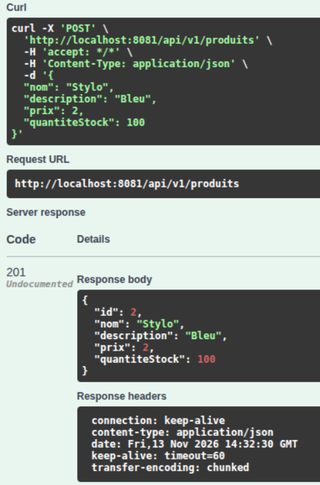
  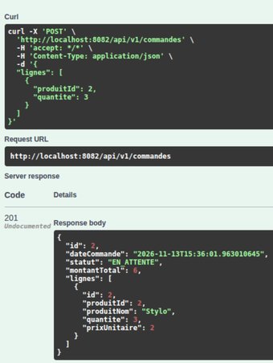
  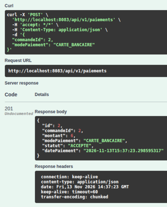

- **Erreurs** : 404 sur un produit absent (vérifié via la Gateway), 400 sur un statut/mode invalide, 400 détaillé sur une validation échouée.

  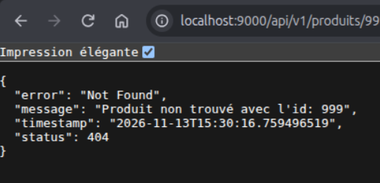

- **Noms logiques** : Feign (`@FeignClient(name="catalogue-service")`) et la Gateway (`uri=lb://catalogue-service`) ne connaissent jamais d'IP ni de port fixe : les deux résolvent ce nom auprès d'Eureka à chaque appel, ce qui permettrait de load-balancer entre plusieurs instances sans rien changer au code.

## Partie 10 - Gestion des données

- **Données partagées dans `univ`** : une seule base `ecommerce` (`produits`, `commandes`, `lignes_commande`, `paiements`), déjà analysée en partie 7 - rien n'empêchait un service d'interroger directement la table d'un autre (même connexion, même utilisateur `postgres`).
- **Une base par service métier** : `catalogue_db`, `commande_db`, `paiement_db`, créées et utilisées depuis les parties 8-9.
- **Isolation renforcée au niveau PostgreSQL** (au-delà du code) : trois rôles dédiés (`catalogue_user`, `commande_user`, `paiement_user`), chacun avec le `CONNECT` retiré à `PUBLIC` sur les deux autres bases. Testé avec `psql` : `catalogue_user` lit bien `catalogue_db`, mais se voit refuser `commande_db` et `paiement_db` (`permission denied for database`) - et inversement pour les deux autres. Avant, les 3 services utilisaient le même superutilisateur `postgres`, qui avait accès à tout.
- **Aucun accès direct inter-services au niveau code** : `LigneCommande` ne référence pas l'entité `Produit` (juste `produitId` + une copie de `produitNom`/`prixUnitaire`), `Paiement` ne référence pas l'entité `Commande` (juste `commandeId` + une copie de `montant`). Aucune jointure SQL n'est possible entre les bases : les clés ne sont que des `Long` applicatifs.
- **Données externes via API interservices** : `CatalogueClient` (Commande -> Catalogue) et `CommandeClient` (Paiement -> Commande) en OpenFeign, déjà testés en partie 9.

## Partie 11 - Installation de Docker

- **Docker Desktop** installé (4.99.0, moteur 29.9.3), contexte `desktop-linux` actif.
```bash
docker --version
# Docker version 29.9.2, build a82e528
docker info
# Server Version: 29.9.3, Operating System: Docker Desktop, Context: desktop-linux
```
- **Conteneur de test** :
```bash
docker run hello-world
```
```
Hello from Docker!
This message shows that your installation appears to be working correctly.
```
- **Explication du résultat** : ce message prouve que la chaîne complète fonctionne, en 4 étapes affichées par le conteneur lui-même :
  1. le client `docker` a contacté le daemon Docker (le moteur) ;
  2. le daemon n'a pas trouvé l'image `hello-world` en local, il l'a donc téléchargée depuis Docker Hub ;
  3. le daemon a créé un conteneur à partir de cette image et exécuté son programme (qui ne fait qu'afficher ce message, puis se termine) ;
  4. la sortie du conteneur a été renvoyée jusqu'au terminal.

  Concrètement : build/pull d'image, création de conteneur, exécution isolée, et récupération des logs - exactement le cycle de vie qu'on va réutiliser pour les 6 microservices (partie 12 et suivantes).

## Partie 12 - Création des Dockerfiles

- **Compilation** : `mvn clean package` depuis la racine `ecommerce-microservices` produit les 6 JAR exécutables (fait en partie 8/9).
- **Un `Dockerfile` par microservice**, à la racine de chaque module (même structure pour les 6, seuls le nom du JAR et le port changent) :

```dockerfile
FROM eclipse-temurin:27-jre

WORKDIR /app
COPY target/catalogue-service-0.0.1-SNAPSHOT.jar app.jar

EXPOSE 8081

ENTRYPOINT ["java", "-jar", "app.jar"]
```

| Service | Port exposé |
|---|---:|
| `discovery-service` | 8761 |
| `config-service` | 8888 |
| `gateway-service` | 9000 |
| `catalogue-service` | 8081 |
| `commande-service` | 8082 |
| `paiement-service` | 8083 |

- **Image de base** : `eclipse-temurin:27-jre` (runtime seulement, pas le JDK complet) - même famille que le JDK 27 installé en local, image officielle vérifiée disponible sur Docker Hub.
- **Testé** : `docker build` + `docker run` sur `discovery-service` -> conteneur démarré, Eureka répond `HTTP 200` sur le port mappé, logs confirmant `Started DiscoveryServiceApplication`. Conteneur et image de test supprimés ensuite.
- **Pourquoi une image par service, déployable indépendamment** : chaque `Dockerfile` ne copie qu'un seul JAR, donc chaque image ne contient que le code et les dépendances d'un seul service - pas les 5 autres. Ça permet de reconstruire et redéployer `catalogue-service` sans toucher aux images des autres, de faire évoluer leurs versions séparément, et de ne scaler (plusieurs conteneurs) que le service qui en a besoin. C'est l'exact opposé de `univ` : un seul JAR pour 6 applications aurait donné une seule image Docker pour tout, remettant en cause l'indépendance de déploiement qu'on cherche à obtenir depuis la partie 8.

## Partie 13 - Construction des images Docker

Depuis la racine `ecommerce-microservices`, une image par service, taguée `1.0` :
```bash
docker build -t discovery-service:1.0 ./discovery-service
docker build -t config-service:1.0 ./config-service
docker build -t gateway-service:1.0 ./gateway-service
docker build -t catalogue-service:1.0 ./catalogue-service
docker build -t commande-service:1.0 ./commande-service
docker build -t paiement-service:1.0 ./paiement-service
```
```
docker images
IMAGE                   ID             DISK USAGE   CONTENT SIZE
catalogue-service:1.0   d4857f783d78        636MB          194MB
commande-service:1.0    26b220b8413f        637MB          195MB
config-service:1.0      1aee12985047        558MB          157MB
discovery-service:1.0   d65fbece8a39        587MB          171MB
gateway-service:1.0     3bfb38fe2ebb        571MB          163MB
paiement-service:1.0    f7367c1665ae        637MB          195MB
```
Les 6 images sont construites avec succès. Chaque taille affichée (« DISK USAGE ») inclut l'image de base `eclipse-temurin:27-jre` partagée entre les 6 - leur poids réel propre (« CONTENT SIZE ») ne va que de 157 à 195 Mo.

Remarque pour la suite : `eclipse-temurin:27-jre` n'est pas une image Alpine, donc chaque image reste assez lourde. Une variante `27-jre-alpine` réduirait sensiblement la taille si c'était un critère important ici.


## Partie 14 - Exécution individuelle des conteneurs

- **Réseau Docker** : `docker network create ecommerce-net` (driver `bridge`).
- **Ordre de démarrage** : infra d'abord (`discovery-service`, `config-service`), puis les 3 services métier, puis la Gateway en dernier.
```bash
docker run -d --name discovery-service --network ecommerce-net -p 8761:8761 discovery-service:1.0
docker run -d --name config-service --network ecommerce-net -p 8888:8888 config-service:1.0

docker run -d --name catalogue-service --network ecommerce-net -p 8081:8081 \
  -e CONFIG_URL=http://config-service:8888 \
  -e EUREKA_URL=http://discovery-service:8761/eureka/ \
  -e DB_URL=jdbc:postgresql://host.docker.internal:5433/catalogue_db \
  -e DB_USER=catalogue_user -e DB_PASSWORD=catalogue_pwd \
  catalogue-service:1.0
# (même principe pour commande-service:8082 et paiement-service:8083, avec leurs identifiants)

docker run -d --name gateway-service --network ecommerce-net -p 9000:9000 \
  -e CONFIG_URL=http://config-service:8888 \
  -e EUREKA_URL=http://discovery-service:8761/eureka/ \
  gateway-service:1.0
```
- **Variables d'environnement** : `CONFIG_URL` et `EUREKA_URL` pointent vers les *noms de conteneurs* (`config-service`, `discovery-service`), pas vers `localhost`. `DB_URL`/`DB_USER`/`DB_PASSWORD` pointent vers `host.docker.internal` (PostgreSQL tourne encore en dehors de ce réseau, sur l'hôte) avec les rôles restreints créés en partie 10.
- **`docker ps`** :
```
discovery-service   Up   0.0.0.0:8761->8761/tcp
config-service      Up   0.0.0.0:8888->8888/tcp
catalogue-service    Up   0.0.0.0:8081->8081/tcp
commande-service    Up   0.0.0.0:8082->8082/tcp
paiement-service    Up   0.0.0.0:8083->8083/tcp
gateway-service     Up   0.0.0.0:9000->9000/tcp
```
- **`docker logs catalogue-service`** : `Started CatalogueServiceApplication`, puis `DiscoveryClient_CATALOGUE-SERVICE... - registration status: 204` -> enregistrement Eureka réussi.
- **Eureka** : les 4 clients `UP`. **API** : données déjà existantes toujours lisibles, et une nouvelle chaîne complète (produit -> commande, 45 € × 2 = 90 €) fonctionne via la Gateway (9000) exactement comme en local.
- **Pourquoi `localhost` ne désigne pas un autre conteneur** : chaque conteneur a son propre *network namespace*, donc son propre `localhost` (127.0.0.1), qui ne désigne jamais que lui-même - jamais un autre conteneur, même sur le même réseau Docker. Preuve : `discovery-service` (vu depuis `catalogue-service`) se résout en `172.18.0.2`, l'IP réelle du conteneur `discovery-service` sur `ecommerce-net`, alors que `catalogue-service` lui-même est en `172.18.0.4`. C'est le DNS interne de Docker (sur un réseau *bridge* personnalisé) qui résout le **nom du conteneur** vers son IP réelle - `localhost` à l'intérieur de `catalogue-service` ne pointerait que vers `catalogue-service` lui-même, jamais vers `discovery-service`. D'où l'usage de `EUREKA_URL=http://discovery-service:8761/...` plutôt que `localhost:8761`.

## Partie 15 - Intégration de Docker Compose

- **`docker compose version`** -> `v5.7.0`.
- **`docker-compose.yml`** créé à la racine `ecommerce-microservices`, déclarant les 6 services, chacun associé à son image `:1.0`, avec ports publiés, variables d'environnement (`EUREKA_URL`, `CONFIG_URL`, `DB_URL`/`DB_USER`/`DB_PASSWORD`), `depends_on` (infra -> métier -> gateway), et un réseau interne dédié `ecommerce-net` (bridge) où chaque service est joignable par son nom de conteneur (ex. `http://discovery-service:8761`, `http://config-service:8888`).
- **`docker compose up -d`** puis **`docker compose ps`** : les 6 conteneurs `Up`.

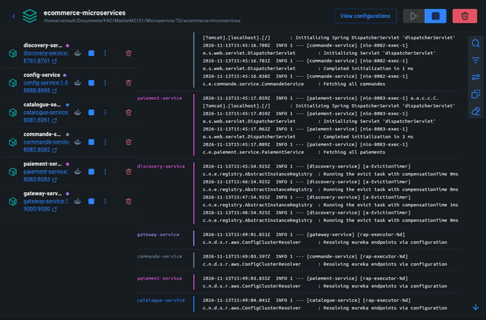

**Problème rencontré et corrigé** : au premier démarrage, `catalogue-service`/`commande-service`/`paiement-service` plantaient (`Failed to determine a suitable driver class`) et `gateway-service` démarrait sans configuration (routes absentes, Eureka retombé sur `localhost:8761` par défaut). Cause : `depends_on` ne garantit que l'ordre de *démarrage des conteneurs*, pas que l'application à l'intérieur soit déjà prête à répondre - `config-service` mettait ~7 s à démarrer réellement, et l'import `spring.config.import=optional:configserver:...` n'essayait qu'une fraction de seconde avant d'abandonner silencieusement (étant `optional:`).
- Correctif appliqué : `spring.cloud.config.fail-fast=true` + `spring.cloud.config.retry.*` (jusqu'à 10 tentatives, 2 à 5 s d'intervalle) dans les 4 clients, avec la dépendance `spring-retry` nécessaire pour que ces réessais soient réellement exécutés. `restart: on-failure` ajouté en complément dans `docker-compose.yml`, qui a aussi masqué le premier symptôme (crash) le temps que la vraie cause soit identifiée.

- **Tests** : Eureka (`:8761`) montre les 4 clients `UP` ; Config Server (`:8888`) répond `HTTP 200` ; les 3 endpoints `GET /api/v1/produits`, `/commandes`, `/paiements` via la Gateway (`:9000`) renvoient toutes les données déjà créées lors des parties précédentes (4 produits, 4 commandes, 3 paiements) - la persistance traverse les redémarrages de conteneurs puisque PostgreSQL tourne encore hors de ce réseau, atteint via `host.docker.internal`.

## Partie 16 - Persistance et bases de données

- **Une instance PostgreSQL dédiée par service métier**, ajoutée dans `docker-compose.yml` : `catalogue-db`, `commande-db`, `paiement-db` (image `postgres:17`), sur le même réseau `ecommerce-net`. Avant, les 3 services partageaient le même *serveur* PostgreSQL (juste 3 bases séparées dessus) ; maintenant, ce sont 3 serveurs PostgreSQL entièrement distincts - isolation physique complète, pas seulement logique.
- **Identifiants et URL JDBC via variables d'environnement** : chaque instance Postgres reçoit `POSTGRES_DB`/`POSTGRES_USER`/`POSTGRES_PASSWORD`, et chaque service métier pointe vers *son* instance par son nom de conteneur : `DB_URL=jdbc:postgresql://catalogue-db:5432/catalogue_db` (et pareil pour les deux autres) - plus besoin de `host.docker.internal`, tout reste dans le réseau Docker.
- **Volumes persistants** : un volume nommé par base (`catalogue-db-data`, `commande-db-data`, `paiement-db-data`), monté sur `/var/lib/postgresql/data`.
- **Migration des données existantes** : les données déjà créées pendant les parties précédentes (4 produits, 4 commandes, 3 paiements) ont été extraites de l'ancien PostgreSQL partagé (`pg_dump`) puis réinjectées dans les 3 nouvelles instances.
- **Test de persistance (16.4)** : `docker compose down` (suppression de **tous** les conteneurs, volumes conservés) puis `docker compose up -d` (recréation complète depuis les images). Résultat : les 4 produits, 4 commandes et 3 paiements sont toujours là, lisibles directement en base comme via la Gateway - preuve que ce sont les volumes qui portent les données, pas les conteneurs eux-mêmes, qui sont jetables par définition.

## Partie 17 - Healthchecks, supervision et validation

- **Endpoints Actuator** : `/actuator/health` déjà actif sur les 6 applications (exposition par défaut suffisante, pas besoin de `management.endpoints.web.exposure.include=*`).
- **Healthchecks Docker Compose** ajoutés aux 9 conteneurs (`curl -f .../actuator/health` pour les 6 apps - `curl` installé dans chaque `Dockerfile` à cet effet, absent de l'image `eclipse-temurin:27-jre` de base ; `pg_isready` pour les 3 Postgres). `depends_on` passe en `condition: service_healthy` partout : c'est la vraie correction du problème de course au démarrage contourné à la partie 15 (`spring-retry`) - Compose attend maintenant que chaque dépendance soit *réellement prête*, pas juste démarrée. Résultat : `docker compose up -d` démarre les 9 conteneurs `healthy` sans aucun crash, du premier coup.
- **Test d'arrêt/redémarrage** : `docker compose stop catalogue-service` -> Eureka passe l'instance à `DOWN` en quelques secondes (le client Eureka se désinscrit proprement pendant l'arrêt `SIGTERM`, pas besoin d'attendre l'expiration du bail). `docker compose start catalogue-service` -> ré-enregistrement avec le même `instanceId`, repasse à `UP`, de nouveau fonctionnel immédiatement.
- **Comportement de la Gateway et d'OpenFeign pendant l'indisponibilité** - deux phases observées :
  1. Juste après l'arrêt : erreur DNS (`Name or service not known`) - la Gateway (et le `CatalogueClient` Feign de `commande-service`) a encore en cache l'ancien nom de conteneur, que Docker ne résout plus.
  2. Une fois les caches locaux rafraîchis (~30 s, indépendant d'Eureka lui-même) : réponse propre `503 Unable to find instance for catalogue-service` côté Gateway (log : `No servers available for service: catalogue-service`), et côté `commande-service`, le `RetryAwareServiceInstanceListSupplier` logue explicitly qu'il retire l'instance indisponible de sa recherche, avant que notre `GlobalExceptionHandlerCommande` ne transforme l'échec Feign en réponse JSON propre (`"error":"Service Communication Error"`).
  - Les deux clients (Gateway et Feign) ont donc chacun leur propre cache local de la liste d'instances, rafraîchi indépendamment du registre Eureka central - une requête peut échouer plusieurs dizaines de secondes après qu'Eureka a déjà constaté la panne.
- **`docker compose logs`** : logs des 9 conteneurs interleaved par nom, confirmant toute la chronologie ci-dessus (arrêt de `catalogue-db`/`commande-db`/`paiement-db` au redémarrage complet, ré-enregistrement Eureka, etc.).

## Partie 18 - Construction automatique et arrêt

- **`build:` ajouté aux 6 services applicatifs** dans `docker-compose.yml` (pas aux 3 `postgres:17`, qui restent des images officielles) :
```yaml
catalogue-service:
  build:
    context: ./catalogue-service
    dockerfile: Dockerfile
  image: catalogue-service:1.0
  ...
```
Garder `image:` en plus de `build:` permet à Compose de taguer l'image construite avec le même nom qu'avant (cohérent avec la partie 13) ; en développement, `docker compose build` (ou `up --build`) reconstruit directement depuis le `Dockerfile` de chaque service, sans repasser par un `docker build -t ...` manuel pour chacun.
- **Reconstruction et validation** : `docker compose build` (6 images reconstruites), puis `docker compose up -d --build` -> les 9 conteneurs `healthy`, Eureka montre les 3 services métier `UP`, et les 4 produits déjà en base sont toujours accessibles via la Gateway.
- **Arrêt propre** : `docker compose down` (sans `-v`) supprime les 9 conteneurs et le réseau, mais les 3 volumes (`catalogue-db-data`, `commande-db-data`, `paiement-db-data`) restent bien présents (`docker volume ls`) - les données seront là au prochain `docker compose up -d`.

**État à la fin de cette partie : l'environnement est arrêté.** `docker compose up -d` dans `ecommerce-microservices/` le relance.

## Partie 19 - Livrables et évaluation

### Code, Dockerfile, docker-compose.yml

Tout est dans `ecommerce-microservices/` : les 6 applications Spring Boot (chacune avec son `pom.xml`, son code, sa configuration locale et son `Dockerfile`), le `pom.xml` parent, et `docker-compose.yml` à la racine.

### Rapport : démarche, séparation des données, problèmes et solutions

**Démarche de migration.** Le projet `univ` (un seul `pom.xml`, 6 classes `main`, un seul JAR) a été scindé en 6 modules Maven indépendants (partie 8), en reprenant le code existant sans le réécrire - seuls les packages ont été renommés. La configuration a été centralisée sur un Config Server (partie 9), la découverte de services confiée à Eureka, et la Gateway mise en place comme point d'entrée unique routant par nom logique plutôt que par IP/port fixe.

**Séparation des données.** `univ` partageait une seule base PostgreSQL entre les 3 services métier (partie 7). La séparation s'est faite en trois temps : d'abord une base logique par service sur un même serveur partagé (partie 10), avec des rôles PostgreSQL restreints empêchant tout accès croisé au niveau des identifiants (pas seulement au niveau du code) ; puis une instance PostgreSQL physiquement séparée par service, conteneurisée avec un volume dédié (partie 16). Chaque service ne connaît que ses propres entités JPA ; les données d'un autre service ne sont obtenues que par appel REST (OpenFeign), jamais par accès direct à sa base - avec une conséquence assumée : cohérence à terme, pas de transaction distribuée (justifié en partie 10).

**Problèmes rencontrés et solutions.**
- `univ` : Config Server cherchant ses fichiers au mauvais endroit, routes Gateway en syntaxe obsolète, 500 au lieu de 404 sur un produit absent, faute de frappe sur un nom de classe - tous corrigés pendant la migration (parties 7-8).
- Dépendance manquante (`eureka-client-jersey3`) une fois les services séparés : présente dans `univ` seulement par transitivité via le serveur Eureka partagé (partie 8).
- Course au démarrage en environnement conteneurisé : `config-service` pas encore prêt quand les autres tentaient de le joindre, échec silencieux (`optional:`). Contourné d'abord avec des réessais applicatifs (`spring-retry`, partie 15), puis corrigé pour de bon avec des healthchecks Docker Compose et `depends_on: condition: service_healthy` (partie 17).
- Caches locaux (Gateway et Feign) décorrélés du registre Eureka central : une instance tombée en panne peut encore recevoir du trafic pendant plusieurs dizaines de secondes après sa désinscription (partie 17) - limite assumée du design, pas un bug.

### Démonstration : redéploiement indépendant d'un microservice

Avec les 9 conteneurs démarrés et sains, seul `catalogue-service` a été modifié (version de l'API Swagger : 1.0 -> 1.1), recompilé et redéployé seul :
```bash
docker compose up -d --build catalogue-service
```
Résultat vérifié par les ID de conteneur et leur ancienneté : `catalogue-service` a reçu un nouvel ID et un nouvel âge (quelques secondes), tandis que les **8 autres conteneurs** (`discovery-service`, `config-service`, `gateway-service`, `commande-service`, `paiement-service`, les 3 bases) ont gardé exactement le même ID et la même ancienneté - aucun n'a redémarré. Le changement de version est visible (`/v3/api-docs` renvoie `1.1`), et la chaîne complète (produits, commandes, Eureka) continue de fonctionner sans interruption pendant et après l'opération. C'est la preuve concrète de l'indépendance de déploiement recherchée depuis la partie 8.

### Résultat attendu 

Une application e-commerce répartie en 6 microservices autonomes, avec découverte de services (Eureka), configuration centralisée (Config Server), Gateway, communication interservices (OpenFeign), bases de données dédiées (PostgreSQL × 3, rôles restreints, volumes) et orchestration locale par Docker Compose (healthchecks, build local, arrêt propre) - obtenu et vérifié de bout en bout dans les parties 7 à 18.
